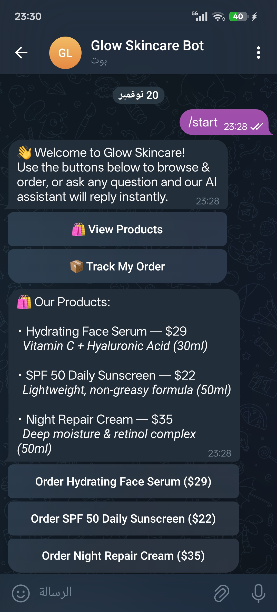
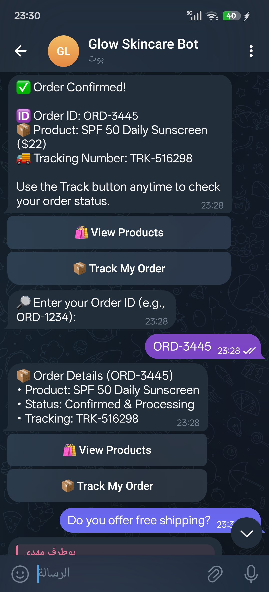
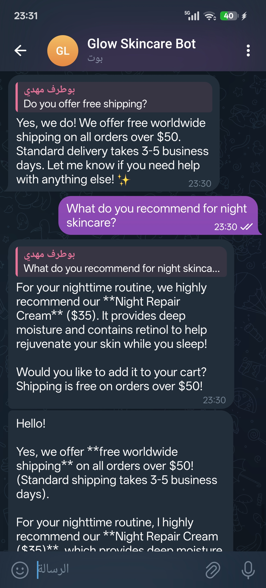

# Glow Skincare — AI-Powered Telegram E-Commerce Bot

An automated Telegram sales and customer support bot built with **Python**, **SQLite**, and **Google Gemini AI**.

## Features
- **Interactive Product Catalog:** Clean inline keyboard menus to browse products and place orders directly inside Telegram.
- **Automated Order Management:** Generates unique Order IDs and Tracking Numbers stored locally in an SQLite database.
- **Self-Service Order Tracking:** Customers can look up real-time order status anytime using their Order ID.
- **24/7 AI Customer Support:** Powered by Google Gemini (`gemini-flash-lite-latest`) to answer shipping, pricing, and skincare recommendation questions automatically.
- 
## Demo Screenshots

  
  
  

## Tech Stack

- Python 3
- `pyTelegramBotAPI`
- `google-genai`
- SQLite3
- 
## Setup & Usage
1. Install dependencies: `pip install -r requirements.txt`
2. Set your environment variables:
   - `TELEGRAM_TOKEN` — Your bot token from @BotFather
   - `GEMINI_API_KEY` — Your API key from Google AI Studio
3. Run the bot: `python bot.py`

